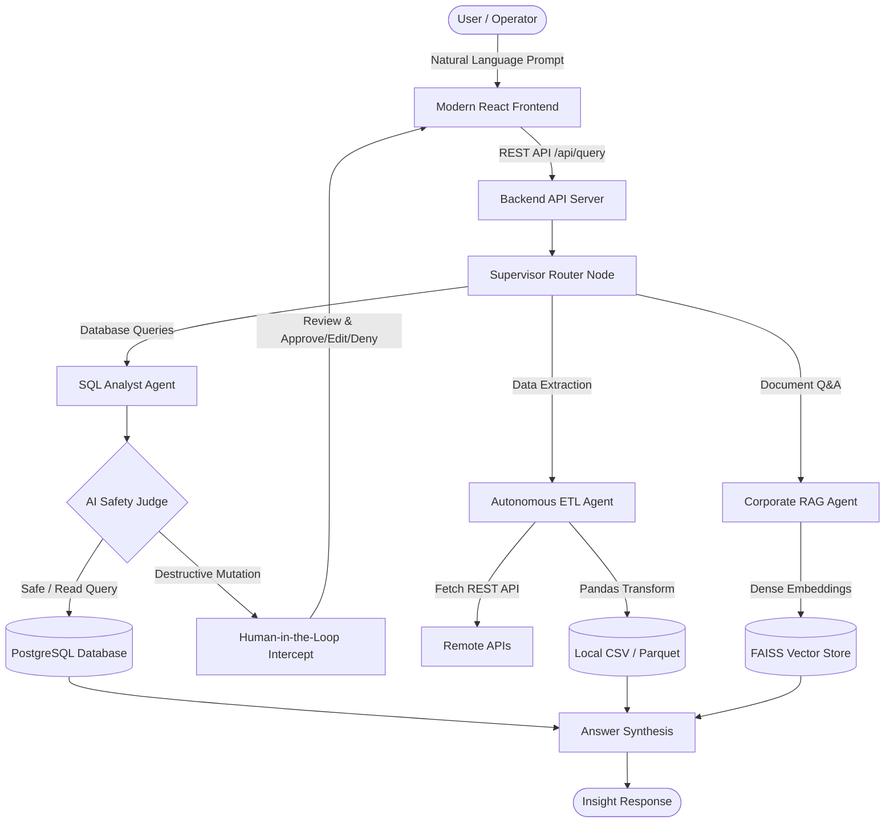

# 🤖 DataAgent: Autonomous Multi-Agent Data & Knowledge Platform

[](https://www.python.org/)
[](https://github.com/langchain-ai/langgraph)
[](https://react.dev/)
[](https://vitejs.dev/)
[](https://www.postgresql.org/)
[](https://groq.com/)

---

## 📖 Overview

**DataAgent** is an enterprise-ready, autonomous multi-agent AI platform built with **LangGraph**, **FastAPI/HTTP**, and a modern **React 19** frontend. It seamlessly interprets natural language user intents and routes them to specialized agents capable of database schema introspection, SQL generation with **Human-in-the-Loop (HITL)** safety guardrails, autonomous REST API data extraction/ETL pipelines, and hybrid document knowledge retrieval (RAG).



---

## ✨ Key Features & Specialized Agents

### 1. 🔍 Text-to-SQL Analyst Agent (`sql_analyst.py`)
- **Automated Schema Introspection**: Dynamically queries live PostgreSQL catalogs to extract table definitions, column types, primary/foreign keys, and sample rows.
- **Smart Result Limiting**: Enforces a default 5-row maximum limit on queries when unspecified by the user to avoid unconstrained database load.
- **AI Safety Evaluation**: Inspects every generated SQL query for dangerous operations (`DROP`, `DELETE`, `UPDATE`, `TRUNCATE`, `ALTER`).
- **Human-in-the-Loop (HITL) Interception**: When destructive queries or explicit approval flags are detected, execution pauses and securely yields execution control to the operator with query editing, execution approval, and rejection capabilities.

### 2. ⚡ Autonomous ETL Agent (`etl_agent.py`)
- **Dynamic API Extraction**: Fetches structured and semi-structured payloads from remote HTTP/REST endpoints (e.g., PokéAPI, public data APIs).
- **On-the-Fly Code Generation**: Automatically writes and executes isolated Pandas transformation scripts to clean, normalize, and restructure datasets.
- **File Persistence**: Exports processed data into structured formats (`data/extract/*.csv`) with full schema preservation.

### 3. 📚 Corporate Knowledge RAG Agent (`rag_agent.py`)
- **Semantic Vector Search**: Indexed via **FAISS** vector store using `sentence-transformers/all-MiniLM-L6-v2` embeddings.
- **Hybrid Retrieval**: Employs dense vector similarity search combined with BM25 reranking for high recall and factual precision.
- **Grounded Answering**: Directly cites sources and synthesizes answers strictly bound to indexed document contents.

### 4. 🎛️ Supervisor Router (`data_agent.py`)
- **Structured Routing**: Powered by Pydantic schema validation (`RouterSchema`) to classify and forward user prompts to the correct node with low latency.
- **State Reducer Architecture**: Implements clean state updates across LangGraph channels, preventing duplicate messages and managing context statefully.

---

## 🎨 Modern Web Interface

The frontend is built with **React 19**, **Vite**, and custom responsive styles:
- **Palette**: `#FAFAFA` navbar, `#1C1E53` midnight navy accents, `#E5E5E5` clean canvas, and pure `#FFFFFF` cards.
- **Interactive HITL Banner**: Displays intercepted SQL queries, reason for review, risk analysis, an editable SQL code editor, and one-click **Approve** or **Deny** buttons.
- **Quick Preset Scenarios**: Preconfigured quick-launch queries for SQL analytics, destructive test queries, ETL extractions, and knowledge RAG.
- **Real-Time Backend Health Monitoring**: Live status indicator checking API connectivity.
- **Raw JSON & Formatted View**: Toggle between conversational answers and raw JSON execution outputs.

---

## 🏗️ Project Structure

```text
dataAgent/
├── agents/                       # Specialized AI Agents
│   ├── data_agent.py             # LangGraph Supervisor Orchestrator
│   ├── sql_analyst.py            # SQL Analyst with HITL & Safety Judge
│   ├── etl_agent.py              # Autonomous API Extraction & Pandas ETL
│   └── rag_agent.py              # Retrieval-Augmented Generation Agent
├── datas/                        # Database Seeding Resources
│   └── csv/                      # Sample business data
│       ├── customers.csv         # Customer records
│       ├── employee.csv          # Employee salaries & departments
│       ├── sales.csv             # Sales transactions & revenue
│       └── store.csv             # Store branch locations
├── models/                       # Type-Safe Schemas & Contracts
│   └── schema.py                 # Pydantic state, routing, and safety models
├── utils/                        # Core Utilities
│   └── database.py               # PostgreSQL connection management & rollbacks
├── test/                         # Test Scripts
│   └── sql_analysts.py           # Verification script for SQL agent & HITL
├── Frontend/                     # Modern React 19 + Vite Application
│   ├── src/
│   │   ├── App.jsx               # Main UI component & state machine
│   │   ├── App.css               # Component & card design styles
│   │   ├── index.css             # Global tokens & theme palette
│   │   └── main.jsx              # React DOM entrypoint
│   ├── public/
│   │   └── image.png             # Application logo
│   ├── package.json              # Frontend scripts & dependencies
│   └── vite.config.js            # Vite config with backend proxy (/api)
├── data/extract/                 # Output folder for generated ETL datasets
├── feed_db.py                    # PostgreSQL schema builder & CSV loader
├── server.py                     # HTTP API Server with CORS & HITL endpoints
├── pyproject.toml                # Python package metadata & dependencies
└── README.md                     # Documentation
```

---

## 🛠️ Technology Stack

| Component | Technology | Description |
| :--- | :--- | :--- |
| **Language** | Python 3.13+ | Fast, modern runtime managed with `uv` |
| **Agent Framework** | LangGraph 1.2+ & LangChain | Stateful multi-agent cyclical graphs & supervisors |
| **LLM Inference** | Groq (`ChatGroq`) | Ultra-low latency inference running `openai/gpt-oss-120b` |
| **Vector Database** | FAISS (`faiss-cpu`) | In-memory similarity search for document retrieval |
| **Embeddings** | HuggingFace Sentence-Transformers | Dense vector representations (`all-MiniLM-L6-v2`) |
| **Relational Database** | PostgreSQL & `psycopg2-binary` | Production business database & transaction control |
| **Data Processing** | Pandas 3.0+ | Dynamic data extraction, transformation, and CSV output |
| **Validation** | Pydantic v2 | Strictly-typed agent state contracts and API models |
| **Frontend UI** | React 19, Vite, Lucide React | High-performance dashboard with customized aesthetics |

---

## 🚀 Getting Started

### 1. Prerequisites
- **Python 3.13+** installed (or install via [`uv`](https://github.com/astral-sh/uv))
- **Node.js 18+** and **npm**
- **PostgreSQL** running locally or accessible remotely

### 2. Clone and Setup Environment

```bash
git clone https://github.com/navneetpathak1/DataFlow_AI.git
cd DataFlow_AI
```

Create a `.env` file in the project root:

```env
# Groq LLM Key
GROQ_API_KEY=your_groq_api_key_here

# PostgreSQL Database Configuration
host=localhost
port=5432
database=dataagent_db
user=postgres
password=your_db_password

# Server Settings (Optional)
SERVER_HOST=127.0.0.1
SERVER_PORT=8000
```

### 3. Install Python Dependencies

Using `uv`:
```bash
uv sync
```

Or using standard `pip`:
```bash
python -m venv .venv
# Windows:
.venv\Scripts\activate
# Linux/macOS:
source .venv/bin/activate

pip install -r requirements.txt  # or pip install -e .
```

### 4. Seed the Database

Populate the PostgreSQL database with the store, employee, customer, and sales datasets:

```bash
python feed_db.py
```

### 5. Launch the Backend Server

Start the API server (listening on port `8000`):

```bash
python server.py
```

Verify backend health:
```bash
curl http://127.0.0.1:8000/api/health
```

### 6. Launch the Frontend

In a separate terminal window:

```bash
cd Frontend
npm install
npm run dev
```

Open `http://localhost:5173` in your browser.

---

## 📡 API Reference

### `GET /api/health`
Checks backend service availability and connectivity.
- **Response**: `200 OK`
```json
{
  "status": "online",
  "service": "DataAgent API",
  "time": "2026-10-26T13:30:00.000Z",
  "endpoints": ["/api/health", "/api/query", "/api/approve-sql"]
}
```

### `POST /api/query`
Main routing endpoint for conversational queries.
- **Payload**:
```json
{
  "question": "Retrieve the names and salaries of the top 2 highest-paid employees",
  "require_approval": false
}
```
- **Response**:
```json
{
  "success": true,
  "route": "sql",
  "result": "The top 2 highest-paid employees are John Doe ($95,000) and Jane Smith ($92,000).",
  "needs_approval": false,
  "approval_data": null,
  "elapsedSeconds": 1.42,
  "timestamp": "2026-10-26T13:30:01.420Z"
}
```

### `POST /api/approve-sql`
Executes or cancels an intercepted SQL query during a Human-in-the-Loop review.
- **Payload**:
```json
{
  "decision": "approved",
  "sql_query": "DELETE FROM employee WHERE salary > 50000;",
  "user_question": "Delete employees with salary > 50000"
}
```
- **Response**:
```json
{
  "success": true,
  "result": "Query executed successfully. 2 rows affected.",
  "status": "Query approved and executed successfully."
}
```

---

## 🧪 Testing & Verification

Run the standalone SQL analyst safety and schema introspection test suite:

```bash
python test/sql_analysts.py
```

Test scenarios covered:
- Standard analytical queries (automatic 5-row capping).
- Destructive query interception (`DELETE`, `TRUNCATE`).
- Human approval bypass and execution.

---

## 🛡️ License

Distributed under the MIT License. See `LICENSE` for more information.
