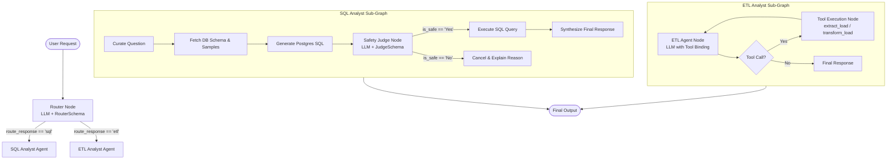

# 🤖 DataAgent: Autonomous Multi-Agent Data & SQL Platform

[](https://www.python.org/)
[](https://github.com/langchain-ai/langgraph)
[](https://github.com/langchain-ai/langchain)
[](https://groq.com/)
[](https://www.postgresql.org/)
[](https://pandas.pydata.org/)
[](https://docs.pydantic.dev/)

**DataAgent** is an intelligent, multi-agent AI system designed to automate data engineering and database analytics. Built with **LangGraph**, **LangChain**, **Pydantic**, and **Groq LLMs**, it autonomously routes natural language requests to either an **Autonomous ETL Agent** or a **Text-to-SQL Analyst Agent** with built-in query safety guardrails.

---

## 🌟 Key Features

- **🎯 Intelligent Router**: Automatically classifies user queries into SQL data analysis vs. ETL data pipeline operations using structured output routing.
- **🛡️ Secure Text-to-SQL Pipeline**:
  - Live PostgreSQL schema and sample row inspection for contextual awareness.
  - Automatic query curation and generation.
  - **AI Safety Judge**: Pre-execution security check that rejects harmful DDL/DML mutations (`DROP`, `DELETE`, `UPDATE`, `TRUNCATE`, `ALTER`).
  - Conversational summary of query results.
- **⚡ Autonomous ETL Pipeline**:
  - **Extract & Load**: Fetches data from external REST APIs and saves into CSV, JSON, or Parquet.
  - **Dynamic Transformation**: Samples existing files, generates custom Pandas transformation code on-the-fly, and executes it to output refined datasets.
- **📊 Graph Visualization**: Visual representations of agent workflows exported natively via Mermaid and PNG.

---

## 🛠️ Technology Stack

| Technology | Role | Description |
| :--- | :--- | :--- |
| **[Python 3.13+](https://www.python.org/)** | Runtime | Modern Python environment managed with `uv`. |
| **[LangGraph](https://github.com/langchain-ai/langgraph)** | Agent Workflow | State machines, cyclical ReAct loops, and multi-agent coordination. |
| **[LangChain](https://github.com/langchain-ai/langchain)** | Agent Tools & Messaging | Core tool bindings, message models (`HumanMessage`, `AIMessage`, `ToolMessage`). |
| **[Groq (`ChatGroq`)](https://groq.com/)** | LLM Inference | High-speed LLM execution (`openai/gpt-oss-120b`). |
| **[PostgreSQL](https://www.postgresql.org/)** | Relational Database | Ride-sharing domain dataset storing users, vehicles, rides, payments, and ratings. |
| **[psycopg2-binary](https://www.psycopg.org/)** | DB Connector | Executes bulk loads, schema introspection, and analytical queries. |
| **[Pandas](https://pandas.pydata.org/)** | Data Processing | Data frame manipulation, normalization (`json_normalize`), and file conversions. |
| **[Pydantic v2](https://docs.pydantic.dev/)** | State & Schemas | Type-safe graph states, router contracts, and judge outputs. |
| **[python-dotenv](https://github.com/theskumar/python-dotenv)** | Configuration | Secure management of database credentials and API keys. |

---

## 🏗️ System Architecture

DataAgent uses a hierarchical supervisor-worker multi-agent architecture:



### Generated Graph Visualizations
- Master Agent: `data_agent_graph.png`
- SQL Analyst: `sql_analyst_graph.png`
- ETL Analyst: `etl_analyst_graph.png`

---

## 📂 Project Structure

```text
dataAgent/
├── agents/
│   ├── data_agent.py          # Master supervisor graph and intent router
│   ├── etl_analyst.py         # Autonomous ETL ReAct agent with tools
│   └── sql_analyst.py         # Text-to-SQL agent with schema context and safety judge
├── models/
│   └── schema.py              # Pydantic schemas for state, router, and judge
├── utils/
│   ├── database.py            # PostgreSQL connector, schema introspection & executor
│   ├── etl_tools.py           # API data extraction and dynamic Pandas execution
│   └── llm_pick.py            # Tiered LLM provider loader (Groq)
├── data/
│   ├── users.csv              # Seed dataset: riders and drivers
│   ├── vehicles.csv           # Seed dataset: driver vehicles
│   ├── rides.csv              # Seed dataset: trips and fares
│   ├── payments.csv           # Seed dataset: transaction logs
│   ├── ratings.csv            # Seed dataset: customer reviews
│   ├── extract/               # Staging directory for API extracted data
│   └── transform/             # Output directory for transformed data
├── feed_db.py                 # DDL migration & high-speed CSV loader into Postgres
├── main.py                    # Project entrypoint
├── test_schema_details.txt    # Cached schema snapshot for public tables
├── pyproject.toml             # uv package and dependency definitions
└── .env                       # Environment variables (API keys and DB credentials)
```

---

## 🔄 End-to-End Workflow Examples

### 1. Natural Language Database Querying
When a user asks:
> *"What are the different types of payment method available in our database?"*

1. **Router**: Identifies query type as `"sql"`.
2. **Curator**: Cleans and standardizes the question.
3. **Context Provider**: Reads column types and sample rows from the PostgreSQL database.
4. **SQL Generator**: Produces `SELECT DISTINCT payment_method FROM public.payments;`.
5. **Safety Judge**: Verifies no destructive statements exist (`is_safe = "Yes"`).
6. **Execution**: Fetches tuples from PostgreSQL.
7. **Final Answer**: Returns conversational answer to the user.

---

### 2. Autonomous API Extraction & Transformation
When a user asks:
> *"Extract Pokemon data from 'https://pokeapi.co/api/v2/pokemon' into data/extract in CSV format and filter for Bulbasaur."*

1. **Router**: Identifies query type as `"etl"`.
2. **Extract Tool**: Issues an HTTP GET request, normalizes nested JSON results using Pandas, and saves `data/extract/extracted_data.csv`.
3. **Transform Tool**: Samples the top rows of the CSV, generates Python Pandas code to filter for Bulbasaur, executes the script, and writes the output to `data/transform/`.

---

## 🚀 Getting Started

### 1. Prerequisites
- [Python 3.13+](https://www.python.org/) or [`uv`](https://github.com/astral-sh/uv)
- [PostgreSQL](https://www.postgresql.org/) database instance
- [Groq API Key](https://console.groq.com/)

### 2. Installation
Clone the repository and install dependencies:

```bash
# Using uv (recommended)
uv sync

# Or using pip
pip install -r <(uv pip compile pyproject.toml)
```

### 3. Environment Setup
Create a `.env` file in the root directory:

```env
GROQ_API_KEY="your-groq-api-key"

# PostgreSQL Configuration
host="localhost"
port="5432"
user="postgres"
password="your_password"
database="rideshare_db"
```

### 4. Database Initialization
Seed your PostgreSQL database with the sample ride-sharing dataset:

```bash
python feed_db.py
```

### 5. Running the Agent
Run the main pipeline:

```bash
python main.py
```

Or invoke the individual agents directly:

```bash
# Run the SQL Analyst directly
python agents/sql_analyst.py

# Run the ETL Analyst directly
python agents/etl_analyst.py

# Run the Master Supervisor Agent
python agents/data_agent.py
```

---

## 🔒 Security & Safety Design

- **Read-Only Enforced via LLM Judge**: Generated SQL statements undergo automated inspection prior to execution. If destructive DDL/DML statements (`DROP`, `DELETE`, `UPDATE`, `TRUNCATE`, `ALTER`) are detected, execution is immediately canceled.
- **Row Limit Guardrails**: Generated SQL queries default to limiting results to 10 rows unless explicitly requested otherwise, protecting memory and database performance.
